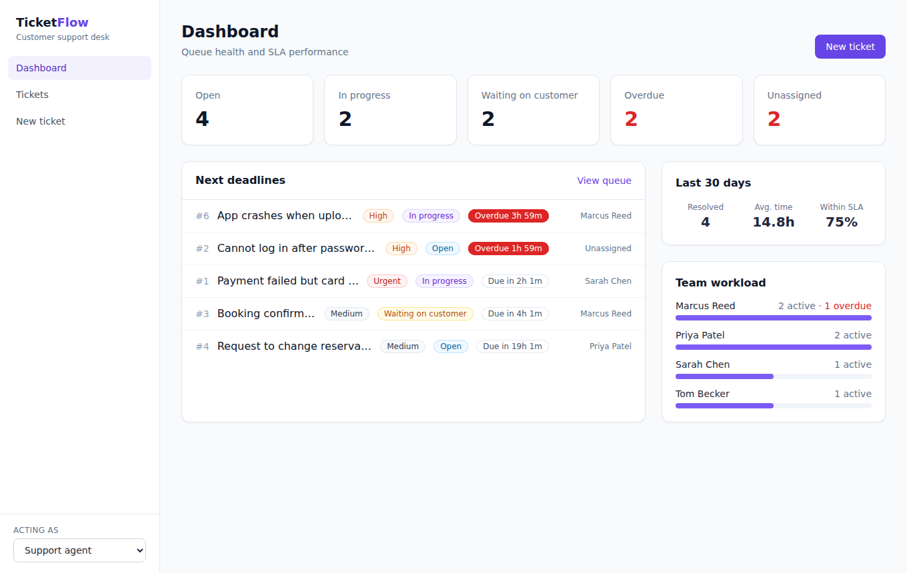
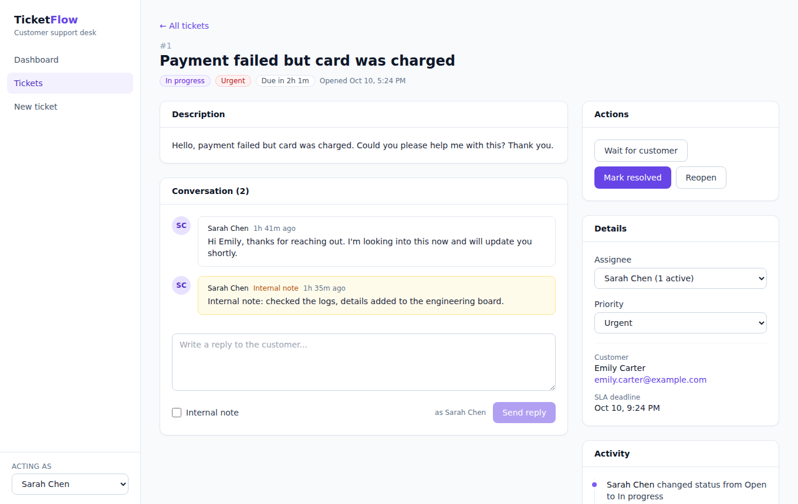

# TicketFlow — Customer Support Ticketing

A full-stack help desk for a small support team: agents take tickets from a shared queue, reply to
customers, leave internal notes for each other and move tickets through a clear workflow while every
ticket's SLA deadline counts down in real time.

**Stack:** Next.js 16 (React 19) · Node.js + Express · PostgreSQL 16 · Zod · Jest + Supertest · Vitest · Tailwind CSS · Docker



---

## Features

| Area | What it does |
| --- | --- |
| **Dashboard** | Open / in progress / waiting / overdue / unassigned counters (each one opens the filtered list), next deadlines, resolution stats for the last 30 days, team workload |
| **Ticket queue** | Search (subject, customer name, email), filters for status, priority, assignee and overdue, three sort orders, pagination. Filters live in the URL, so a filtered view can be bookmarked or shared and the back button works |
| **Ticket page** | Conversation with public replies and internal notes, status buttons generated from the allowed workflow, assignee and priority changes, "Assign to me", activity timeline |
| **SLA tracking** | Deadline set from priority (urgent 4h, high 8h, medium 24h, low 72h), live "Due in / Overdue" badges, "resolved within SLA" check |
| **New ticket** | Form with server-side validation; field errors are shown next to the fields |
| **API** | REST endpoints with input validation, one error format, correct HTTP status codes, audit trail of every change |



---

## Feature case study: a status workflow that cannot be broken

Support tools go wrong in small ways: a ticket is "in progress" with nobody working on it, a closed ticket
gets a new reply that nobody reads, a deadline is not updated after the priority changes. TicketFlow
handles these rules in one place and checks them on every layer.

**1. One source of truth for the workflow.**
`ticket.rules.js` holds the allowed status changes as plain data, with no database access, so it is easy to unit test:

```js
const STATUS_TRANSITIONS = {
  open:                ['in_progress', 'waiting_on_customer', 'resolved'],
  in_progress:         ['waiting_on_customer', 'resolved', 'open'],
  waiting_on_customer: ['in_progress', 'resolved'],
  resolved:            ['closed', 'open'],
  closed:              [],
};
```

**2. The API enforces it and explains why.**
`POST /api/tickets/:id/status` locks the ticket row (`SELECT ... FOR UPDATE`) inside a transaction, so two agents
clicking at the same moment are handled one after another. A forbidden change returns `422` with a message
the UI shows as-is, e.g. *"Assign the ticket to an agent before starting work on it"*. Every successful change
writes an event (who, from, to, when) in the same transaction, so the activity timeline is always complete.

**3. The UI never offers an impossible action.**
Each ticket in the API response carries `allowedTransitions`, and the ticket page renders its buttons from that
list. There is no second copy of the rules in the frontend that could drift out of sync.

**4. Related data stays consistent.**
- `resolved_at` is set when a ticket is resolved, kept when it is closed, and cleared when it is reopened;
  a database `CHECK` constraint rejects any other combination.
- Changing the priority recalculates the deadline from the ticket's creation time, not from "now".
- Closed tickets reject edits and new comments (`422 TICKET_CLOSED`); the UI disables those controls.

---

## Bug prevention: classic bugs covered by tests

| Classic bug | How it is prevented | Proof |
| --- | --- | --- |
| **Search returns tickets from other statuses.** `status = $1 AND subject ILIKE $2 OR email ILIKE $2` without parentheses matches any status. | The search conditions are grouped in parentheses | API test *"combined filters: search never leaks tickets from other statuses"*. Removing the parentheses makes it fail |
| **Two agents change the same ticket at once** and one change is lost or skipped | Row lock (`FOR UPDATE`) in a transaction for every write | Status, assignment and comment writes all go through `lockTicket()` |
| **Old results replace new ones** when filters change quickly | Every request is aborted when a newer one starts (`AbortController` in `useApi`) | The list can only show the response for the current URL |
| **A success message next to stale data** after a change | The message appears only after the refreshed ticket has loaded | Found and fixed by the end-to-end check while building this project |
| **Hydration mismatch from "2h ago" labels** rendered on the server | The clock is read with `useSyncExternalStore` and is empty on the server | No hydration warnings in the browser console |

---

## Architecture

```
web/  (Next.js, client components)
  └─ lib/api.js        fetch wrapper: JSON, error format -> ApiError(code, message, fields)
  └─ lib/useApi.js     data loading hook: loading / error / reload, aborts stale requests
  └─ lib/format.js     labels, durations, SLA state, activity text (unit tested)
        │  HTTP JSON
        ▼
api/  (Express)
  └─ modules/tickets/tickets.routes.js    validation with zod (400 + field errors)
  └─ modules/tickets/tickets.service.js   SQL + transactions + events, business errors (404 / 422)
  └─ modules/tickets/ticket.rules.js      pure rules: SLA hours, workflow, overdue
  └─ middleware/errorHandler.js           one error format for the whole API
        │  pg (parameterized queries only)
        ▼
PostgreSQL  (CHECK constraints, foreign keys, indexes for the queue filters)
```

Error format used by every endpoint:

```json
{ "error": { "code": "ASSIGNEE_REQUIRED",
             "message": "Assign the ticket to an agent before starting work on it",
             "details": {} } }
```

---

## API reference

| Method | Endpoint | Description |
| --- | --- | --- |
| GET | `/api/health` | Health check (also checks the database connection) |
| GET | `/api/dashboard` | Queue counters, last 30 days stats, workload, next deadlines |
| GET | `/api/agents` | Active agents with their number of active tickets |
| GET | `/api/tickets?status=&priority=&assigneeId=&overdue=&search=&sort=&page=&pageSize=` | Paginated queue. `status=active` = not resolved, `assigneeId=unassigned`, `sort=newest\|due\|priority` |
| POST | `/api/tickets` | Create a ticket (deadline set from priority) |
| GET | `/api/tickets/:id` | Ticket with comments, events and allowed status changes |
| PATCH | `/api/tickets/:id` | Change priority and/or assignee (`assigneeId: null` unassigns) |
| POST | `/api/tickets/:id/status` | Change status (checked against the workflow) |
| POST | `/api/tickets/:id/comments` | Add a public reply or an internal note |

Write requests accept an optional `actor` (the agent's name), which is stored in the activity timeline.
In the UI it comes from the "Acting as" selector in the sidebar.

---

## Getting started

Requirements: **Node.js 22.12+**, **Docker Desktop** (or your own PostgreSQL 16).

```bash
# 1. Database (PostgreSQL on localhost:5434, plus a separate test database)
docker compose up -d

# 2. API  ->  http://localhost:4001
cd api
cp .env.example .env          # Windows PowerShell: Copy-Item .env.example .env
npm install
npm run db:migrate
npm run db:seed               # 4 agents and 12 tickets with deadlines around the current time
npm run dev

# 3. Web  ->  http://localhost:3001   (in a second terminal)
cd web
cp .env.example .env.local    # Windows PowerShell: Copy-Item .env.example .env.local
npm install
npm run dev
```

Ports 4001 / 3001 / 5434 are used so this project can run next to other local projects.

## Tests

```bash
cd api && npm test     # 25 API tests: rules, validation, workflow, filters, dashboard (real PostgreSQL)
cd web && npm test     # API client, SLA and formatting unit tests
cd web && npm run lint && npm run build
```

The API tests run against the separate `ticketflow_test` database. GitHub Actions runs the same
checks on every push (`.github/workflows/ci.yml`).

---

## Project structure

```
02-ticketflow/
├── api/
│   ├── src/
│   │   ├── app.js, server.js, config.js
│   │   ├── db/            pool, migration runner, seed, migrations/*.sql
│   │   ├── lib/           HttpError helpers, zod validation middleware
│   │   ├── middleware/    error handler
│   │   └── modules/       tickets, agents, dashboard
│   └── tests/             Jest + Supertest
├── web/
│   ├── app/               dashboard, tickets, tickets/new, tickets/[id]
│   ├── components/        sidebar, badges, loading / empty / error states
│   ├── lib/               api client, data hook, formatting, clock, "acting as"
│   └── tests/             Vitest
├── db-init/               creates the test database in Docker
└── docker-compose.yml
```

## Decisions and known limitations

- **Timestamps** are stored as `TIMESTAMPTZ` and shown in the browser's local time.
- **SLA hours are calendar hours.** Business hours and holidays would be the next step for a real team.
- **Authentication is out of scope** for this demo. "Acting as" stands in for the logged-in agent; in
  production the actor would come from the session, not from the request body.
- Email is not sent; replies are stored in the ticket. An email integration (inbound and outbound) would
  plug into `addComment`.
